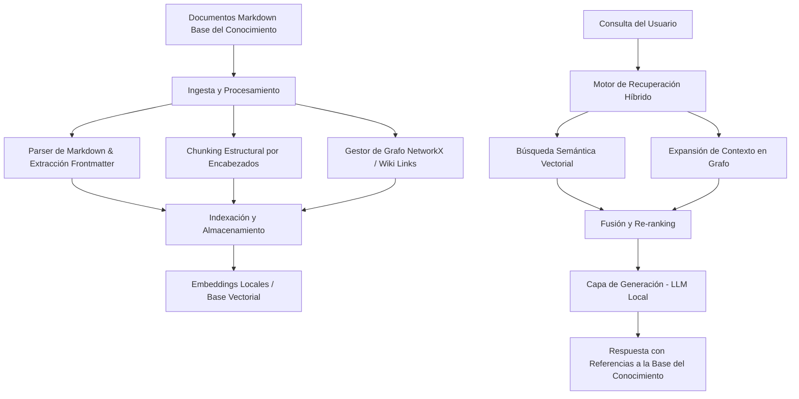

# Graph RAG para Base del Conocimiento

Sistema avanzado de Recuperación Aumentada por Generación (RAG) basado en Grafos de Conocimiento y Búsqueda Vectorial, diseñado específicamente para operar en entornos locales (*on-premise*) y asegurar la privacidad y soberanía de la documentación de la Base del Conocimiento.

---

## 📌 Características Principales

- **Privacidad y Soberanía Total:** Procesamiento, indexación y ejecución de modelos totalmente locales, sin dependencias de APIs en la nube.
- **Mantenimiento del Contexto Estructural:** Explotación de la topología documental subyacente en archivos Markdown (enlaces tipo wiki `[[enlace]]`, metadatos frontmatter y jerarquía de encabezados).
- **Recuperación Híbrida (Graph + Vector):**
  - **Búsqueda Vectorial Semántica:** Recuperación de fragmentos mediante similitud de coseno (dense retrieval) con embeddings ligeros locales.
  - **Búsqueda por Palabra Clave:** Búsqueda de texto exacto (`keyword_search`) sobre contenido de chunks para recuperar términos técnicos específicos (ej. puertos `XGE1/0/25`, IPs, VLANs) que embeddings semánticos pueden no encontrar.
  - **Búsqueda Relacional en Grafo:** Exploración de nodos vecinos en el grafo de conocimiento para rescatar contexto complementario y dependencias cruzadas.
- **Generación Local (LLM):** Integración con motores LLM locales para la síntesis de respuestas con referencias precisas a los ficheros originales de la Base del Conocimiento.

---

## 🏗️ Arquitectura del Sistema



---

## 📂 Estructura del Proyecto

```text
grafrac/
├── config/              # Configuración centralizada (pydantic-settings)
├── data/                # Documentos de la Base del Conocimiento y persistencia local
├── docs/                # Documentación y esquemas (mindmap, SVG)
├── src/                 # Código fuente (ingestion, graph, vectorstore, retrieval, generation, api, ui, config)
├── tests/               # Pruebas unitarias e integración
├── requirements.txt     # Dependencias de Python
├── README.md            # Documentación principal
└── release.md           # Notas de versión
```

---

## ⚙️ Despliegue y Pruebas (Dev & Producción)

### 1. Entorno de Desarrollo (Dev)

Para configurar y probar el proyecto en un entorno local de desarrollo:

1. **Clonar el repositorio y acceder al directorio:**
   ```bash
   cd grafrac
   ```
2. **Crear y activar un entorno virtual de Python:**
   ```bash
   python3 -m venv venv
   source venv/bin/activate
   ```
3. **Instalar las dependencias:**
   ```bash
   pip install -r requirements.txt
   ```
4. **Configurar el entorno:**
   - Coloca los archivos Markdown de tu Base del Conocimiento en el directorio `data/` o configura la ruta en `config/`.
5. **Ejecutar pruebas unitarias:**
   ```bash
   PYTHONPATH=. pytest tests/ -v
   ```

### 5.5. Configuración por Variables de Entorno (`.env`)

El sistema lee su configuración desde un archivo `.env` en la raíz del proyecto (ignorado en git vía `.gitignore`). Copia `.env.example` a `.env` y ajusta los valores según tu entorno:

```bash
cp .env.example .env
# Edita .env con tu editor preferido
PYTHONPATH=. pytest tests/ -v
```

Todas las variables están centralizadas en `src/config/settings.py` (pydantic-settings) y se cargan automáticamente al iniciar cualquier componente (`LocalLLMClient`, `VectorStoreManager`, `KnowledgeGraphManager`, `KnowledgeBaseIndexer`, etc.).

### 6. Ejecución de la TUI Textual (Interfaz de Terminal)

Como alternativa a la interfaz web Streamlit, el proyecto incluye una TUI basada en [Textual](https://textual.textualize.io/) que reusa los mismos componentes de negocio (grafo, vector store, retriever, LLM):

```bash
python3 src/ui/tui.py
```

La TUI incluye chat interactivo, barra lateral de configuración (backend, URL, timeout, top-k, radio de grafo), botón de indexación Base del Conocimiento y estadísticas del grafo. No requiere servidor web y se ejecuta directamente en la terminal.

### 7. Ejecución del Chat CLI Interactivo (Fase 7)

Para realizar consultas conversacionales interactivas directamente desde la terminal utilizando el motor de recuperación híbrida y el LLM local:

```bash
python3 run_chat.py llamacpp http://localhost:8080
```

### 8. Ejecución de la Interfaz Web Visual (Streamlit - Fase 8A)

Para iniciar la interfaz gráfica de usuario web para consultas interactivas, configuración y reindexación:

```bash
streamlit run src/ui/app.py
```

Para levantar el servidor API REST en local y exponer los endpoints de consulta híbrida y indexación:

```bash
uvicorn src.api.main:app --host 0.0.0.0 --port 8000 --reload --ws none
```

Endpoints disponibles:
- `GET /health`: Estado de salud del servicio.
- `POST /index`: Ejecuta la indexación de los documentos de la Base del Conocimiento.
- `POST /query`: Realiza una consulta híbrida (vectorial + grafo) y síntesis con LLM local.


Para ejecutar la demostración completa del sistema (Fase 5) indexando la documentación de la Base del Conocimiento, realizando recuperación híbrida y consultando al LLM local (ej. Llama.cpp en `http://localhost:8080`):

```bash
python3 run_demo.py
```

Para realizar consultas personalizadas o pruebas puntuales con el cliente LLM local especificando un tiempo de espera (`timeout`):

```bash
python3 -c "
from src.generation.local_llm import LocalLLMClient

llm = LocalLLMClient(backend='llamacpp', base_url='http://localhost:8080', timeout=300)
context = [{
    'content': 'La OLT1 se bloqueó a las 03:45 AM del 12 de octubre de 2026 debido a un fallo de alimentación en el rack principal.',
    'metadata': {'title': 'Registro de Incidencias OLT', 'source_path': 'data/incidencias_red.md'}
}]
response = llm.generate_response('¿Cuándo se bloqueó la OLT1?', context)
print('Respuesta:\n', response)
"
```


### 2. Entorno de Producción (Host Definitivo On-Premise)

Para el despliegue definitivo en el servidor local de producción asegurando la soberanía de datos:

1. **Requisitos del Servidor:**
   - Sistema operativo Linux (Ubuntu/Debian recomendado) u otro entorno compatible.
   - Python 3.10 o superior instalado.
    - [Ollama](https://ollama.com/) o **[llama.cpp](https://github.com/ggerganov/llama.cpp)** (servidor nativo `llama-server`) para la inferencia de LLM local on-premise.
      - **Con Ollama:**
        ```bash
        curl -fsSL https://ollama.com/install.sh | sh
        ollama serve &
        ollama pull llama3
        ```
      - **Con llama.cpp (Servidor Nativo):**
        ```bash
        # Para entornos con recursos limitados (recomendado para pruebas locales):
        llama-server -hf ggml-org/gemma-3-1b-it-GGUF -c 2048 --port 8080
        
        # Para producción con mayor hardware:
        llama-server -hf bartowski/Qwen2.5-3B-Instruct-GGUF:Q4_K_S -c 4096 --port 8080
        ```
         *Nota:* El cliente `LocalLLMClient` en `src/generation/local_llm.py` soporta ambos backends configurando `backend="ollama"` o `backend="llamacpp"`. Permite configurar el tiempo de espera mediante el parámetro `timeout` (por defecto 300 segundos):
         ```python
         client = LocalLLMClient(backend="llamacpp", base_url="http://localhost:8080", timeout=300)
         ```
2. **Clonación y Configuración en Producción:**
   ```bash
   git clone <url-repositorio> grafrac
   cd grafrac
   python3 -m venv venv
   source venv/bin/activate
   pip install -r requirements.txt
   ```
3. **Persistencia y Permisos (⚠️ IMPORTANTE para Producción):**
   - Asegurar permisos de lectura y escritura en la carpeta `data/` (para evitar errores de base de datos de lectura en ChromaDB y el grafo JSON):
     ```bash
     sudo chown -R $USER:$USER data/
     ```
4. **Ejecución como Servicio (Systemd):**
   Crear un archivo de servicio en `/etc/systemd/system/grafrac.service`:
   ```ini
   [Unit]
   Description=Graph RAG para Base del Conocimiento
   After=network.target ollama.service

   [Service]
   User=tu_usuario
   WorkingDirectory=/ruta/a/grafrac
   ExecStart=/ruta/a/grafrac/venv/bin/python main.py
   Restart=always

   [Install]
   WantedBy=multi-user.target
   ```
   Habilitar y arrancar el servicio:
   ```bash
   sudo systemctl enable --now grafrac.service
   ```

---

## 🖥️ Optimización para Hardware Limitado (CPU solo, sin GPU)

El sistema está preparado para ejecutarse exclusivamente en CPU con modelos ultraligeros. Para entornos con recursos limitados:

### Modelo LLM recomendado (1B)
Lanza `llama-server` con Gemma 3 1B cuantificado:

```bash
# Modelo ligero, ideal para CPU sin GPU
llama-server -hf ggml-org/gemma-3-1b-it-Q4_K_M-GGUF -c 2048 --port 8080
```

Luego consulta:
```bash
python3 run_chat.py llamacpp http://localhost:8080
```

### Parámetros por defecto optimizados (`src/config/settings.py`)
| Parámetro | Valor | Efecto |
|-----------|-------|--------|
| `llm_model_name` | `llama-3.2-3b` | Modelo 3B para respuestas precisas en CPU (alias en `llama-server`) |
| `llm_n_predict` | 512 | Máximo de tokens generados por respuesta |
| `llm_temperature` | 0.3 | Menor variación, respuestas más deterministas |
| `llm_ctx_size` | 4096 | Ventana de contexto ampliada |
| `default_top_k` | 20 | Más fragmentos recuperados antes del filtrado |
| `MAX_CONTEXTS_PER_SOURCE` (retriever) | 10 | Tope de contextos por fuente de documento |
| `EMBEDDING_MODEL` | `paraphrase-multilingual-mpnet-base-v2` | Embeddings 768 dims, mejor para español y términos técnicos |
| `extraction_enabled` | `false` | Extracción de entidades/relaciones por LLM durante el indexado (Opción C) |
| `extraction_model` | `null` | Modelo LLM para extracción (usa `llm_model_name` si es null) |
| `entity_similarity_threshold` | `0.9` | Umbral de similitud para fusionar entidades duplicadas |

### Deduplicación de contextos
Cada consulta elimina automáticamente fragmentos repetidos (por `chunk_id` y por hash de contenido) tanto de la búsqueda vectorial como de la expansión de grafo, evitando respuestas "corta-pega" y fuentes duplicadas.

---

## 🧩 Extractor de Entidades y Relaciones (Opcional)

El proyecto incluye un módulo de extracción opcional (`src/graph/extractor.py`) que permite enriquecer el grafo de conocimiento con entidades y relaciones extraídas mediante LLM durante el indexado.

### Opción A — Base pipeline sin LLM (recomendado para desarrollo)

Esta es la configuración por defecto (`extraction_enabled = false`). El pipeline funciona así:

```
Markdown Parser → Chunker → Vector Store (ChromaDB) + Knowledge Graph (nodos de documento + enlaces wiki_link)
```

Ventajas:
- ✅ Rápido (no requiere servidor LLM durante el indexado)
- ✅ Funciona en hardware limitado (CPU solo)
- ✅ Los tests unitarios pasan sin servicios externos

Desventajas:
- ❌ El grafo solo contiene nodos de documento y enlaces wiki, no entidades técnicas extraídas (IPs, VLANs, equipos, etc.)

### Opción C — Extracción con LLM (recomendado para producción en hardware potente)

Cuando dispongas de hardware con GPU o servidor potente, activa `extraction_enabled = true` en `.env`:

```env
EXTRACTION_ENABLED=true
EXTRACTION_MODEL=qwen3-4b-instruct-2507
EXTRACTION_TEMPERATURE=0.1
EXTRACTION_MAX_TOKENS=512
ENTITY_SIMILARITY_THRESHOLD=0.9
```

El extractor:
- Usa salida JSON forzada (`format: "json"`) para reducir fallos de formato
- Extrae entidades (equipos, IPs, VLANs, clientes, servicios) y relaciones dirigidas
- Normaliza nombres para evitar duplicados ("Juan Pérez" ≡ "J. Pérez")
- Vincula cada entidad y relación al `chunk_id` de origen para trazabilidad
- Opcionalmente crea nodos desde el frontmatter (cliente, sistema, categoría, criticidad)

**Pasos para activar Opción C:**

```bash
# 1. Levantar servidor LLM potente
llama-server -hf bartowski/Qwen3-4B-Instruct-2507-Q4_K_M -c 4096 --port 8080

# 2. Activar extracción en .env
EXTRACTION_ENABLED=true

# 3. Reindexar
rm -rf data/vectorstore data/knowledge_graph.json
PYTHONPATH=. python3 -c "
from src.vectorstore.indexer import KnowledgeBaseIndexer
idx = KnowledgeBaseIndexer()
print(idx.run_indexing())
"
```

Más detalles en `TODO.md`.

## 📄 Ingesta de Documentos Word y PDF
Cada consulta elimina automáticamente fragmentos repetidos (por `chunk_id` y por hash de contenido) tanto de la búsqueda vectorial como de la expansión de grafo, evitando respuestas "corta-pega" y fuentes duplicadas.

---

## 📄 Ingesta de Documentos Word y PDF

El sistema puede alimentar el grafo de conocimiento y la base vectorial a partir de documentos Word (.docx) y PDF, convirtiéndolos a Markdown con frontmatter YAML antes de indexarlos.

### Conversor Word → Markdown (`src/ingestion/docx_to_md.py`)
Extrae texto de archivos .docx usando `python-docx` y lo convierte a Markdown con:
- Encabezados (`#`, `##`, `###`) preservando la jerarquía del documento original.
- Negritas y formato básico.
- Frontmatter YAML automático con `id`, `title`, `categoria: importado`, `autor: Sistema Base del Conocimiento`, `creado`, `tags` y `Link to`.
- Enlaces wiki `[[enlace]]` preservados para crear aristas en el grafo.

### Flujo de Uso
```bash
# 1. Convertir un documento Word a Markdown
python3 src/ingestion/docx_to_md.py "data/contrato msp.docx" "data/contrato msp.md"

# 2. Reindexar (el indexer limpia duplicados previos antes de insertar)
POST /index   # vía API, Streamlit o python3 run_demo.py

# 3. Consultar sobre el documento importado
python3 run_chat.py llamacpp http://localhost:8080
```

Los documentos convertidos entran en el pipeline estándar (Parser → Chunker → Grafo → VectorStore) y se recuperan en consultas híbridas igual que cualquier Markdown nativo.

### PDF (pendiente)
Documentado en el backlog para integrar con `pypdf`/`pdfplumber` y OCR (`pytesseract`/`easyocr`) para PDF escaneados.

---

## 🆕 Crear Nuevos Clientes (`scripts/crear_cliente.py`)

Para añadir un nuevo cliente a la Base del Conocimiento sin romper lo existente, usa el script `scripts/crear_cliente.py`. Crea automáticamente el directorio, los archivos Markdown con frontmatter YAML y los enlaces wiki bidireccionales.

### Uso

```bash
# Con los sistemas por defecto (iptv, xgspon, switches, voip, tv, wifi)
PYTHONPATH=. python3 scripts/crear_cliente.py "Nombre del Cliente"

# Con sistemas personalizados
PYTHONPATH=. python3 scripts/crear_cliente.py "Nombre del Cliente" iptv switches wifi

# Con fecha personalizada
PYTHONPATH=. python3 scripts/crear_cliente.py "Nombre del Cliente" --fecha 2026-10-24
```

### Qué crea

Para un cliente `"Hotel Guayarmina"` con sistemas `iptv xgspon switches voip tv wifi`:

```
data/clientes/hotel_guayarmina/
├── hotel_guayarmina.md          # Índice central (enlaza a todos los subsistemas)
├── hotel_guayarmina_iptv.md     # Subsistema IPTV
├── hotel_guayarmina_xgspon.md   # Subsistema XGS-PON
├── hotel_guayarmina_switches.md # Subsistema Switches
├── hotel_guayarmina_voip.md     # Subsistema VoIP
├── hotel_guayarmina_tv.md       # Subsistema TV
└── hotel_guayarmina_wifi.md     # Subsistema WiFi
```

Cada archivo incluye:
- **Frontmatter YAML** con `id` único, `cliente`, `sistema`, `categoria`, `criticidad`, `autor`, `tags`, `link_to` y `fecha_actualizacion`.
- **Enlaces wiki bidireccionales**: el índice central enlaza a todos los subsistemas (`[[hotel_guayarmina_iptv]]`, etc.) y cada subsistema enlaza de vuelta al central (`[[hotel_guayarmina]]`).
- Comentarios `<!-- Rellena aquí ... -->` donde completas el conocimiento real.

### Después de crear clientes

Siempre ejecuta el indexador para generar los chunks en ChromaDB y el grafo:

```bash
PYTHONPATH=. python3 -m src.vectorstore.indexer
```

El indexador es idempotente por archivo: solo reemplaza los chunks del documento editado, sin tocar los clientes existentes.

---

## 🚀 Hoja de Ruta

1. **Fase 1:** Diseño arquitectónico, directrices y estructuración documental. *(Completado)*
2. **Fase 2:** Implementación del Parser de Markdown, extracción de enlaces wiki y construcción del grafo con NetworkX. *(Completado)*
3. **Fase 3:** Configuración del sistema de chunking jerárquico y almacenamiento vectorial local. *(Completado)*
4. **Fase 4:** Desarrollo del motor de recuperación híbrida (Vector + Grafo) y conexión con LLM local. *(Completado)*
5. **Fase 5:** Pruebas de integración sobre documentación real de la Base del Conocimiento y optimización de rendimiento. *(Completado)*
6. **Fase 6:** Capa de Servicio (API REST con FastAPI) y Orquestación. *(Completado)*
7. **Fase 7:** Persistencia del Grafo, Interfaz de Chat CLI Interactiva y Contenerización Docker/Docker Compose. *(Completado)*
8. **Fase 8A:** Interfaz Web Visual con Streamlit y Panel de Control. *(Completado)*
9. **Sprint 1 (v0.9.0):** Mejoras Core - Graph Expansion real, LLM Retry/Backoff, Config Centralizada. *(Completado)*
10. **Sprint 1.1 (v0.9.1):** TUI Textual, Configuración `.env` y Soporte Multi-Interfaz. *(Completado)*
11. **Sprint 1.2 (v0.9.2):** Modelo Ligero 1B, Deduplicación de Contextos y Optimización para Hardware Limitado. *(Completado)*
12. **Sprint 1.3 (v0.9.3):** Ingesta de Documentos Word (.docx) y PDF. *(Completado)*
13. **Sprint 1.6 (v0.9.6):** Extractor de Entidades y Relaciones con LLM (Opción A por defecto, Opción C opcional para producción). *(En Progreso)*
