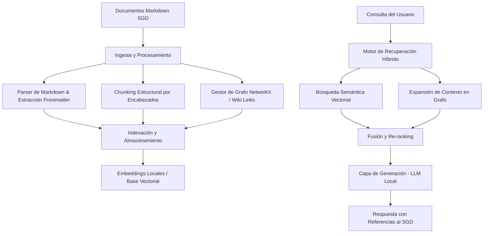

# Graph RAG para SGD (Sistema de Gestión Documental)

Sistema avanzado de Recuperación Aumentada por Generación (RAG) basado en Grafos de Conocimiento y Búsqueda Vectorial, diseñado específicamente para operar en entornos locales (*on-premise*) y asegurar la privacidad y soberanía de la documentación del Sistema de Gestión Documental (SGD).

---

## 📌 Características Principales

- **Privacidad y Soberanía Total:** Procesamiento, indexación y ejecución de modelos totalmente locales, sin dependencias de APIs en la nube.
- **Mantenimiento del Contexto Estructural:** Explotación de la topología documental subyacente en archivos Markdown (enlaces tipo wiki `[[enlace]]`, metadatos frontmatter y jerarquía de encabezados).
- **Recuperación Híbrida (Graph + Vector):**
  - **Búsqueda Vectorial Semántica:** Recuperación de fragmentos mediante similitud de coseno (dense retrieval) con embeddings ligeros locales.
  - **Búsqueda Relacional en Grafo:** Exploración de nodos vecinos en el grafo de conocimiento para rescatar contexto complementario y dependencias cruzadas.
- **Generación Local (LLM):** Integración con motores LLM locales para la síntesis de respuestas con referencias precisas a los ficheros originales del SGD.

---

## 🏗️ Arquitectura del Sistema



---

## 📂 Estructura del Proyecto

```text
grafrac/
├── config/              # Archivos de configuración
├── data/                # Documentos del SGD y persistencia local
├── docs/                # Documentación y esquemas (mindmap, SVG)
├── src/                 # Código fuente (ingestion, graph, vectorstore, retrieval, generation)
├── tests/               # Pruebas unitarias e integración
├── requirements.txt     # Dependencias de Python
├── README.md            # Documentación principal
└── release.md           # Notas de versión
```

---

## ⚙️ Despliegue y Pruebas (Dev & Producción)

### 1. Entorno de Desarrollo (Dev)

Para configurar y probar el proyecto en un entorno local de desarrollo:

1. **Clonar el repositorio y acceder al directorio:**
   ```bash
   cd grafrac
   ```
2. **Crear y activar un entorno virtual de Python:**
   ```bash
   python3 -m venv venv
   source venv/bin/activate
   ```
3. **Instalar las dependencias:**
   ```bash
   pip install -r requirements.txt
   ```
4. **Configurar el entorno:**
   - Coloca los archivos Markdown de tu SGD en el directorio `data/` o configura la ruta en `config/`.
5. **Ejecutar pruebas unitarias:**
   ```bash
   PYTHONPATH=. pytest tests/ -v
   ```

### 4. Demostración de Integración E2E y Consultas LLM Local (`run_demo.py`)

Para ejecutar la demostración completa del sistema (Fase 5) indexando la documentación del SGD, realizando recuperación híbrida y consultando al LLM local (ej. Llama.cpp en `http://localhost:8080`):

```bash
python3 run_demo.py
```

Para realizar consultas personalizadas o pruebas puntuales con el cliente LLM local especificando un tiempo de espera (`timeout`):

```bash
python3 -c "
from src.generation.local_llm import LocalLLMClient

llm = LocalLLMClient(backend='llamacpp', base_url='http://localhost:8080', timeout=300)
context = [{
    'content': 'La OLT1 se bloqueó a las 03:45 AM del 12 de octubre de 2026 debido a un fallo de alimentación en el rack principal.',
    'metadata': {'title': 'Registro de Incidencias OLT', 'source_path': 'data/incidencias_red.md'}
}]
response = llm.generate_response('¿Cuándo se bloqueó la OLT1?', context)
print('Respuesta:\n', response)
"
```


### 2. Entorno de Producción (Host Definitivo On-Premise)

Para el despliegue definitivo en el servidor local de producción asegurando la soberanía de datos:

1. **Requisitos del Servidor:**
   - Sistema operativo Linux (Ubuntu/Debian recomendado) u otro entorno compatible.
   - Python 3.10 o superior instalado.
    - [Ollama](https://ollama.com/) o **[llama.cpp](https://github.com/ggerganov/llama.cpp)** (servidor nativo `llama-server`) para la inferencia de LLM local on-premise.
      - **Con Ollama:**
        ```bash
        curl -fsSL https://ollama.com/install.sh | sh
        ollama serve &
        ollama pull llama3
        ```
      - **Con llama.cpp (Servidor Nativo):**
        ```bash
        # Para entornos con recursos limitados (recomendado para pruebas locales):
        llama-server -hf ggml-org/gemma-3-1b-it-GGUF -c 2048 --port 8080
        
        # Para producción con mayor hardware:
        llama-server -hf bartowski/Qwen2.5-3B-Instruct-GGUF:Q4_K_S -c 4096 --port 8080
        ```
         *Nota:* El cliente `LocalLLMClient` en `src/generation/local_llm.py` soporta ambos backends configurando `backend="ollama"` o `backend="llamacpp"`. Permite configurar el tiempo de espera mediante el parámetro `timeout` (por defecto 300 segundos):
         ```python
         client = LocalLLMClient(backend="llamacpp", base_url="http://localhost:8080", timeout=300)
         ```
2. **Clonación y Configuración en Producción:**
   ```bash
   git clone <url-repositorio> grafrac
   cd grafrac
   python3 -m venv venv
   source venv/bin/activate
   pip install -r requirements.txt
   ```
3. **Persistencia y Permisos:**
   - Asegurar permisos adecuados en las carpetas `data/` y `config/` para que el servicio tenga acceso de lectura a los documentos del SGD y escritura para el grafo/vector store.
4. **Ejecución como Servicio (Systemd):**
   Crear un archivo de servicio en `/etc/systemd/system/grafrac.service`:
   ```ini
   [Unit]
   Description=Graph RAG para SGD
   After=network.target ollama.service

   [Service]
   User=tu_usuario
   WorkingDirectory=/ruta/a/grafrac
   ExecStart=/ruta/a/grafrac/venv/bin/python main.py
   Restart=always

   [Install]
   WantedBy=multi-user.target
   ```
   Habilitar y arrancar el servicio:
   ```bash
   sudo systemctl enable --now grafrac.service
   ```

---

## 🚀 Hoja de Ruta

1. **Fase 1:** Diseño arquitectónico, directrices y estructuración documental. *(Completado)*
2. **Fase 2:** Implementación del Parser de Markdown, extracción de enlaces wiki y construcción del grafo con NetworkX.
3. **Fase 3:** Configuración del sistema de chunking jerárquico y almacenamiento vectorial local.
4. **Fase 4:** Desarrollo del motor de recuperación híbrida (Vector + Grafo) y conexión con LLM local. *(Completado)*
5. **Fase 5:** Pruebas de integración sobre documentación real del SGD y optimización de rendimiento. *(Completado)*
